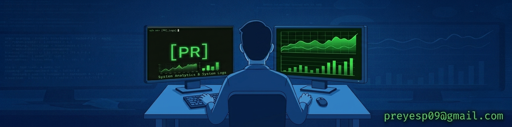

**Español** · [English](https://github.com/Rxyxs/Rxyxs/blob/main/README.en.md)



<div align="center">

# Pablo Reyes

**Científico de Datos · Universidad Mayor · Santiago, Chile**

<a href="https://rxyxs.github.io/"></a>
<a href="https://www.linkedin.com/in/pablo-reyes-pino"></a>
<a href="https://rxyxs.github.io/assets/cv/Pablo_Reyes_CV_ES.pdf"></a>
<a href="mailto:preyesp09@gmail.com"></a>

</div>

---

Soy científico de datos en Santiago. Lo que más me interesa del trabajo es lo que viene después de entrenar el modelo: comprobar si el resultado se sostiene con datos reales y si sirve para tomar una decisión. Por eso la mayoría de mis proyectos usan datos públicos de Chile, como Cochilco, la CMF, ChileCompra o la CNE, y abordan problemas reales de minería, energía y finanzas.

En varios casos el resultado no fue el que esperaba. Un modelo de reingreso hospitalario alcanzaba un AUC de 0,805, pero porque contaba todas las visitas del paciente, incluido el mismo reingreso que debía predecir. Usando solo la información disponible al momento del alta, y evaluándolo con pacientes nuevos, el AUC baja a 0,671. En otro proyecto, cambiarse de fondo de pensiones cuando el mercado está en su punto más bajo parece prudente, pero en 2.000 historias construidas con 24 años de valores cuota reduce la rentabilidad real en 1,9 puntos al año. Publico estos resultados igual que los positivos, y todas las cifras provienen de código que se ejecuta de principio a fin. Y cuando llevé siete proyectos de datos simulados a datos reales, casi todos perdieron su resultado principal; más abajo está cuánto y por qué.

## Proyectos destacados

<table>
<tr>
<td width="50%" valign="top">
<h3><a href="https://github.com/Rxyxs/chile-pension-fund-switching-cost">Cambiarse de fondo de pensiones en pánico</a></h3>
<sub>datos reales · <a href="https://rxyxs.github.io/chile-pension-fund-switching-cost/">página</a></sub>
<p>24 años de valores cuota diarios, en UF. Cambiarse al fondo E en el piso de una caída resta <b>1,9 puntos</b> de rentabilidad real al año; cambiarse antes logra el <b>mismo Sharpe</b> que una mezcla fija: no es acertar el momento, es tener menos renta variable.</p>
<code>duckdb</code> <code>counterfactual-analysis</code> <code>behavioral-finance</code>
</td>
<td width="50%" valign="top">
<h3><a href="https://github.com/Rxyxs/chile-mining-fleet-causal-impact">Impacto causal en una flota minera</a></h3>
<sub>real + simulado · <a href="https://rxyxs.github.io/chile-mining-fleet-causal-impact/">página</a></sub>
<p>¿Funcionó el programa de mantenimiento, y en qué camiones? Con sensores reales de 60.000 camiones Scania, <b>el DRLearner por defecto colapsa (r = −0,01)</b>; se aisló la causa y se recupera a 0,61–0,79.</p>
<code>causal-inference</code> <code>econml</code> <code>difference-in-differences</code>
</td>
</tr>
<tr>
<td width="50%" valign="top">
<h3><a href="https://github.com/Rxyxs/retail-demand-forecasting-favorita">Demanda retail como decisión de inventario</a></h3>
<sub>datos reales · <a href="https://rxyxs.github.io/retail-demand-forecasting-favorita/">página</a></sub>
<p>3.000.888 filas de ventas. Un cuarto de la "demanda cero" eran <b>locales que aún no abrían</b>, y el modelo con mejor métrica deja quiebre de stock en <b>41%</b> de los días-local.</p>
<code>demand-forecasting</code> <code>lightgbm</code> <code>quantile-regression</code>
</td>
<td width="50%" valign="top">
<h3><a href="https://github.com/Rxyxs/chile-mining-ops-agent">Agente de operaciones mineras con LLM local</a></h3>
<sub>datos reales · <a href="https://rxyxs.github.io/chile-mining-ops-agent/">página</a></sub>
<p>Un agente con Qwen 2.5 corriendo en CPU, sobre datos reales de planta y ChileCompra, medido en 100 consultas: elige bien la herramienta <b>99 veces</b>, pero copia mal los montos grandes; devolverlos en millones sube las respuestas ancladas de <b>67 a 86</b>.</p>
<code>llm-agent</code> <code>tool-calling</code> <code>evaluation</code>
</td>
</tr>
</table>

## Lo que cambió con datos reales

Siete proyectos partieron con datos simulados y después los corrí, sin cambiar el método, sobre datos reales. Casi todos perdieron su resultado principal, y entender por qué fue más útil que el número original.

| Proyecto | Métrica | Simulado | Real | Por qué |
|---|---|---:|---:|---|
| **[Pipeline de fraude e-commerce](https://github.com/Rxyxs/fraud-detection-techniques-lab)**<br><sub>IEEE-CIS, 590 mil transacciones</sub> | PR-AUC | 0,993 | **0,052** | Las variables de comportamiento casi no tienen señal en fraude real. |
| **[Motor de fraude C + Ruby + Python](https://github.com/Rxyxs/chile-polyglot-fraud-engine)**<br><sub>IEEE-CIS</sub> | PR-AUC | 1,000 | **0,098** | Dos de sus cuatro reglas nunca se disparan: sus listas eran inventadas. |
| **[AML no supervisado sobre grafo](https://github.com/Rxyxs/fraud-detection-techniques-lab)**<br><sub>Elliptic, 204 mil transacciones Bitcoin</sub> | ROC-AUC | 0,893 | **0,17–0,33** | Lo ilícito es típico, no anómalo: queda bajo el azar. |
| **[Fragmentación de tronadura](https://github.com/Rxyxs/chile-mining-grade-blast-quality-dotnet)**<br><sub>97 tronaduras publicadas, mina nueva</sub> | R² | 0,957 | **−0,59** | Con split aleatorio el modelo reconoce la faena; en una mina nueva es peor que el promedio. |
| **[Detector de order flow (C++)](https://github.com/Rxyxs/lithium-orderbook-imbalance-cpp)**<br><sub>IEX y Binance</sub> | Alertas (meta 0,27%) | 0,02% | **1,4–24%** | Las colas reales son mucho más pesadas que la Student-t supuesta. |
| **[19 detectores de anomalías](https://github.com/Rxyxs/paysim-anomaly-detection-benchmark)**<br><sub>ULB e IEEE-CIS</sub> | ROC-AUC del baseline | 0,383 | **0,931** | El baseline 'peor que el azar' era un artefacto del simulador; el ranking casi no se transfiere. |
| **[Red multi-task de mantenimiento](https://github.com/Rxyxs/failure-prediction-signal-lab)**<br><sub>23.550 camiones SCANIA</sub> | AUC vs. LightGBM | empata | **0,55 vs. 0,65** | La red compartida pierde en las dos tareas con camiones reales. |

## Herramienta abierta

**[datoschile: datos públicos de Chile en una línea](https://github.com/Rxyxs/datoschile)**  
Librería de Python para bajar la UF, el dólar, el cobre, los valores cuota de las AFP y la morosidad bancaria de la CMF, limpios y en un DataFrame. Corrige errores reales de las fuentes, como el dólar filtrado en la UF en 2014 o los tres formatos de los Excel de la CMF, y cada semana verifica que las fuentes no hayan cambiado.

```python
import datoschile as dc

dc.indicadores.uf(desde=2020)
dc.pensiones.indice(fondos="A", desde=2008, real=True)
dc.cmf.morosidad(solo_sistema=True)
```

## Experiencia

**[Control de combustible de una flota de buses](https://github.com/Rxyxs/bus-fleet-fuel-efficiency)** · <sub>trabajo real, datos de ejemplo ficticios</sub>  
Cada uno de los 17 terminales llevaba el combustible en su propio Excel. Primero hice un script en Python que une las planillas, calcula los km por litro de cada bus contra su carga anterior y marca las que quedan fuera del rango de su modelo. Después, una app en AppSheet que reemplazó las planillas: el operador registra cargas, pistolas y estanques desde el celular, y la app calcula consumo por pistola, stock teórico y AdBlue. Al revisar el código corregí tres errores: fechas mal ordenadas entre meses, buses que quedaban sin rango por cómo estaba escrita la norma, y la primera carga de cada bus marcada por error.  
`python` `pandas` `appsheet` `excel` `data-cleaning`

## Proyectos por tipo de problema

43 proyectos en 9 tipos de problema; haz clic en una categoría para abrirla, o míralos todos en el [portafolio](https://rxyxs.github.io/).

<details>
<summary><b>1. Pronosticar lo que viene</b> · 7 proyectos</summary>

| Proyecto | Qué resuelve y qué encontró | Stack |
|---|---|---|
| **[Demanda retail (Favorita)](https://github.com/Rxyxs/retail-demand-forecasting-favorita)**<br><sub>datos reales · [página](https://rxyxs.github.io/retail-demand-forecasting-favorita/)</sub> | Pronóstico evaluado como decisión de compra: los cuantiles solo convienen sobre una razón de costos ~3:1. | `lightgbm` `quantile-regression` `newsvendor` |
| **[Morosidad bancaria en Chile (CMF)](https://github.com/Rxyxs/chile-banking-delinquency-cmf)**<br><sub>datos reales · [página](https://rxyxs.github.io/chile-banking-delinquency-cmf/)</sub> | Panel desde 128 Excel de la CMF. Prueba de tensión con rezago y signos elegidos sin mirar el futuro: solo consumo y comercial le ganan a «sin cambio» (0,73 y 0,85). LightGBM por banco no le gana; SHAP muestra que aprende el régimen. | `stress-testing` `shap` `fastapi` |
| **[Sistema Eléctrico Nacional, horario](https://github.com/Rxyxs/chile-energy-grid-forecasting)**<br><sub>real + simulado</sub> | 5 barras del SEN con clima real (ERA5) y precio anclado al costo marginal real de Crucero. Solar: WAPE 5,55% vs 28,89% del ingenuo; precio 8,77%. | `lightgbm` `optuna` `time-series` |
| **[Sistema Eléctrico Nacional, en R](https://github.com/Rxyxs/chile-energy-grid-forecasting-r)**<br><sub>real + simulado · [página](https://rxyxs.github.io/chile-energy-grid-forecasting-r/)</sub> | Demanda del SEN con energía mensual real y clima ERA5: TBATS MAPE 4,28% vs 6,73% del ingenuo; el MAPE engaña en demanda neta. | `r` `arima` `garch` |
| **[Volatilidad del cobre](https://github.com/Rxyxs/copper-volatility-forecaster)**<br><sub>datos reales · [página](https://rxyxs.github.io/copper-volatility-forecaster/)</sub> | 14 años de precios reales de la LME: GARCH(1,1) tiene el mejor QLIKE y solo HAR-X, con el VIX y el dólar, lo empata. CatBoost ajustado en cada fold no le gana. | `garch` `catboost` `shap` |
| **[Volatilidad de alta frecuencia](https://github.com/Rxyxs/reading-market-turbulence)**<br><sub>datos reales · [página](https://rxyxs.github.io/reading-market-turbulence/)</sub> | 24,8 M de trades de Binance: a 30 s, la persistencia (RMSPE 4,58) le gana a LightGBM y a la red neuronal. | `high-frequency-trading` `lightgbm` `duckdb` |
| **[Valor de vida del cliente](https://github.com/Rxyxs/customer-lifetime-value)**<br><sub>datos reales · [página](https://rxyxs.github.io/customer-lifetime-value/)</sub> | BG/NBD y Gamma-Gamma programados desde la verosimilitud. Prediciendo 26 semanas: **-2%** de error en compras totales, frente a +68% de la tasa ingenua y +24% de LightGBM. | `bg-nbd` `gamma-gamma` `retention` |

</details>

<details>
<summary><b>2. Detectar fraude y anomalías</b> · 7 proyectos</summary>

| Proyecto | Qué resuelve y qué encontró | Stack |
|---|---|---|
| **[Laboratorio de fraude y AML](https://github.com/Rxyxs/fraud-detection-techniques-lab)**<br><sub>datos reales · [página](https://rxyxs.github.io/fraud-detection-techniques-lab/)</sub> | Cuatro técnicas, todas con datos reales: el pipeline de e-commerce cae de PR-AUC 0,993 sintético a 0,052 en IEEE-CIS, y el ensamble AML no supervisado queda bajo el azar en Elliptic (ROC-AUC 0,17-0,33) porque el flujo ilícito es típico, no anómalo. | `fraud-detection` `aml` `xgboost` |
| **[16 detectores sobre fraude móvil](https://github.com/Rxyxs/paysim-anomaly-detection-benchmark)**<br><sub>real + simulado · [página](https://rxyxs.github.io/paysim-anomaly-detection-benchmark/)</sub> | 19 detectores en PaySim y en fraude real (tarjetas ULB, e-commerce IEEE-CIS): el ranking casi no se transfiere (Spearman 0,28-0,38) y en e-commerce ningún detector supera PR-AUC 0,22. | `isolation-forest` `local-outlier-factor` `imbalanced-data` |
| **[Anomalías en compras públicas](https://github.com/Rxyxs/chile-public-procurement-anomalies)**<br><sub>datos reales · [página](https://rxyxs.github.io/chile-public-procurement-anomalies/)</sub> | 13,7 M de líneas de ChileCompra: las Compras Ágiles se acumulan bajo el tope y la acumulación se movió con la ley, pero casi no hay señal de compras partidas. Isolation Forest encuentra el 38,8% de las anomalías plantadas revisando el 5%. | `public-procurement` `bunching` `isolation-forest` |
| **[Motor de fraude políglota](https://github.com/Rxyxs/chile-polyglot-fraud-engine)**<br><sub>real + simulado · [página](https://rxyxs.github.io/chile-polyglot-fraud-engine/)</sub> | El mismo motor C + Ruby + Python sobre 590.540 transacciones reales (IEEE-CIS): PR-AUC 0,098 frente al 1,000 sintético, y sus capas no aportan sobre las features nativas. | `c` `ruby` `prometheus` |
| **[Anomalías en ticks de mercado (C++)](https://github.com/Rxyxs/market-tick-anomaly-engine-cpp)**<br><sub>datos reales</sub> | EWMA y CUSUM validados contra el crash cripto de marzo 2020, a 7,26 M ticks/s. | `cpp` `cusum` `ewma` |
| **[Order flow en acciones de litio (C++)](https://github.com/Rxyxs/lithium-orderbook-imbalance-cpp)**<br><sub>real + simulado · [página](https://rxyxs.github.io/lithium-orderbook-imbalance-cpp/)</sub> | En cintas reales (IEX y Binance) el detector alerta 1,4-24% de las ventanas, no 0,27%, y no anticipa el precio; el día de la noticia del litio (abr 2023) fue un evento de volumen (12x), no de desbalance. | `cpp` `order-flow` `market-microstructure` |
| **[Anomalías en series de sensores (NAB)](https://github.com/Rxyxs/iot-anomaly-benchmark)**<br><sub>datos reales · [página](https://rxyxs.github.io/iot-anomaly-benchmark/)</sub> | Scorer de NAB reimplementado y validado 9/9 contra lo publicado. Reportar solo el inicio de cada excursión lleva un detector estacional de 2,4 a 41; con validación cruzada queda en **42,4**, sobre el baseline gaussiano publicado. | `anomaly-detection` `time-series` `benchmark` |

</details>

<details>
<summary><b>3. Anticipar fallas de equipos</b> · 3 proyectos</summary>

| Proyecto | Qué resuelve y qué encontró | Stack |
|---|---|---|
| **[Mantenimiento predictivo (4 datasets)](https://github.com/Rxyxs/heavy-truck-predictive-maintenance)**<br><sub>datos reales · [página](https://rxyxs.github.io/heavy-truck-predictive-maintenance/)</sub> | 4 datasets públicos (2 de camiones Scania reales, un compresor de metro, turbinas simuladas de la NASA) y 6 familias de modelos: SCANIA reescala cada variable distinto en train, validación y test (AUC adversarial 1,00); corregirlo baja el riesgo predicho de 16,9% a 4,2% (2,7% real). En APS, costo 9.150 vs 9.920 del ganador IDA 2016. | `predictive-maintenance` `distribution-shift` `deep-learning` |
| **[Falla desde señal continua](https://github.com/Rxyxs/failure-prediction-signal-lab)**<br><sub>datos reales</sub> | Rodamientos (NASA IMS), sismos (LANL) y 23.550 camiones SCANIA reales: el boosting espectral le gana a una CNN por 2,5×, y la red multi-task que empataba en la flota sintética pierde con camiones reales (AUC 0,55 vs 0,65). | `remaining-useful-life` `signal-processing` `fft` |
| **[Gemelo digital de molino SAG](https://github.com/Rxyxs/chile-mining-sag-energy-digital-twin)**<br><sub>real + simulado · [página](https://rxyxs.github.io/chile-mining-sag-energy-digital-twin/)</sub> | Kalman estima la dureza del mineral con 79% menos error; energía valorizada con costos marginales reales de la CNE (95 meses). | `digital-twin` `kalman-filter` `lightgbm` |

</details>

<details>
<summary><b>4. Medir causas y evaluar decisiones</b> · 5 proyectos</summary>

| Proyecto | Qué resuelve y qué encontró | Stack |
|---|---|---|
| **[Impacto causal en flota minera](https://github.com/Rxyxs/chile-mining-fleet-causal-impact)**<br><sub>real + simulado · [página](https://rxyxs.github.io/chile-mining-fleet-causal-impact/)</sub> | Uplift y DiD escalonado; el ATT coincide con una implementación de referencia en un panel real. | `causal-inference` `econml` `uplift-modeling` |
| **[Experimentación A/B](https://github.com/Rxyxs/chile-fintech-experimentation-lab)**<br><sub>Monte Carlo · [página](https://rxyxs.github.io/chile-fintech-experimentation-lab/)</sub> | Tamaño muestral, SRM, CUPED y comparaciones múltiples, con un arnés que verifica el error de cada regla. | `ab-testing` `cuped` `power-analysis` |
| **[Fondos de pensiones](https://github.com/Rxyxs/chile-pension-fund-switching-cost)**<br><sub>datos reales · [página](https://rxyxs.github.io/chile-pension-fund-switching-cost/)</sub> | Una señal de régimen que "ganaba" 1,4–2,3% al año empata en Sharpe con una mezcla fija fuera de muestra. En UF, 2021–23 cayó 26%. | `duckdb` `counterfactual-analysis` `pensions` |
| **[Atrasos de entrega en un marketplace (Olist)](https://github.com/Rxyxs/olist-delivery-delays)**<br><sub>datos reales · [página](https://rxyxs.github.io/olist-delivery-delays/)</sub> | 96 mil pedidos reales. Llegar tarde causa **-1,97 puntos** de reseña (AIPW), y casi todo el daño ocurre en la primera semana. Filtrar reseñas previas a la entrega habría botado el 74% de los atrasos. | `causal-inference` `aipw` `survival-analysis` |
| **[Elasticidad precio en supermercado](https://github.com/Rxyxs/retail-price-elasticity)**<br><sub>datos reales · [página](https://rxyxs.github.io/retail-price-elasticity/)</sub> | 580 productos y 2.500 hogares reales. Ignorar exhibición y folleto exagera la elasticidad un 40%; double ML da **-1,50**. Una rebaja de 10% solo se paga sola con margen bruto sobre 50%, incluso en cerveza. | `double-machine-learning` `fixed-effects` `pricing` |

</details>

<details>
<summary><b>5. Optimizar operaciones</b> · 4 proyectos</summary>

| Proyecto | Qué resuelve y qué encontró | Stack |
|---|---|---|
| **[Planta de flotación](https://github.com/Rxyxs/flotation-plant-silica-soft-sensor)**<br><sub>datos reales · [página](https://rxyxs.github.io/flotation-plant-silica-soft-sensor/)</sub> | Planta real de hierro: el R² 0,83 de una partición al azar es -0,43 en orden temporal; solo con laboratorio reciente se le gana a la persistencia, y cuatro modelos recetan pH opuestos. | `soft-sensor` `walk-forward` `optimization` |
| **[Logística de última milla](https://github.com/Rxyxs/chile-spatial-logistics-opt)**<br><sub>comunas reales, demanda simulada · [página](https://rxyxs.github.io/chile-spatial-logistics-opt/)</sub> | Ruteo multi-depósito con ventanas horarias sobre polígonos reales: 0 de 173 zonas sin atender. | `or-tools` `vrptw` `h3` |
| **[Churn como decisión de negocio](https://github.com/Rxyxs/customer-churn-mlops-platform)**<br><sub>datos reales · [página](https://rxyxs.github.io/customer-churn-mlops-platform/)</sub> | 10.000 clientes bancarios reales: la columna de quejas era una fuga (AUC 1,00 vs 0,85); umbral por valor recupera US$189.930 contactando al 42%, vs US$143.842 contactando a todos. | `mlflow` `fastapi` `docker` |
| **[Fallas de calidad en una línea Bosch](https://github.com/Rxyxs/bosch-line-quality)**<br><sub>datos reales · [página](https://rxyxs.github.io/bosch-line-quality/)</sub> | 1,18 M piezas reales: las fallas vienen por lote (11x junto a una pieza fallada). El CV mezclado exagera (0,40 vs 0,21 en piezas futuras). Inspeccionar el 5% más riesgoso atrapa el **61%** de las fallas. | `lightgbm` `imbalanced-learning` `quality-control` |

</details>

<details>
<summary><b>6. Medir y gestionar riesgo financiero</b> · 4 proyectos</summary>

| Proyecto | Qué resuelve y qué encontró | Stack |
|---|---|---|
| **[Laboratorio de riesgo crediticio](https://github.com/Rxyxs/credit-risk-scoring-lab)**<br><sub>macro real, cartera simulada · [página](https://rxyxs.github.io/credit-risk-scoring-lab/)</sub> | 26 técnicas: scorecard R+Python+C a 270,6 M filas/s, PD para IFRS 9, auditoría de sesgo y ciclo shadow/canary/reentrenamiento. | `scorecard` `ifrs9` `mlops` |
| **[Riesgo sistémico en Chile](https://github.com/Rxyxs/chile-fintech-systemic-risk)**<br><sub>datos reales · [página](https://rxyxs.github.io/chile-fintech-systemic-risk/)</sub> | Seis lenguajes sobre datos del Banco Central. El LSTM (51,0%) no le gana a la clase mayoritaria (53,6%). | `julia` `r` `cplusplus` |
| **[Laboratorio cuantitativo cripto](https://github.com/Rxyxs/crypto-quant-techniques-lab)**<br><sub>datos reales · [página](https://rxyxs.github.io/crypto-quant-techniques-lab/)</sub> | Ocho técnicas. Las cinco estrategias pierden tras costos; la detección de spoofing sí funciona (precisión 0,92). | `quantitative-finance` `cointegration` `nlp` |
| **[Opciones asiáticas sobre cobre (C++)](https://github.com/Rxyxs/copper-options-montecarlo-cpp)**<br><sub>modelo de precios · [página](https://rxyxs.github.io/copper-options-montecarlo-cpp/)</sub> | Monte Carlo C++20 bajo GBM, Schwartz y Heston: 9,64× con 16 hilos y un sesgo real corregido. | `cpp20` `monte-carlo` `heston-model` |

</details>

<details>
<summary><b>7. Ordenar y preparar los datos</b> · 4 proyectos</summary>

| Proyecto | Qué resuelve y qué encontró | Stack |
|---|---|---|
| **[Toolkit de limpieza en 4 dominios](https://github.com/Rxyxs/data-cleaning-toolkit)**<br><sub>datos reales · [página](https://rxyxs.github.io/data-cleaning-toolkit/)</sub> | El mismo toolkit sobre Banco Central, COCHILCO y Banco Mundial; detectó un dato corrupto en la fuente. | `data-quality` `pydantic` `pytest` |
| **[Data warehouse minero](https://github.com/Rxyxs/data-warehouse-analitico-mineria-chile)**<br><sub>real + simulado · [página](https://rxyxs.github.io/data-warehouse-analitico-mineria-chile/)</sub> | Anuario real de Cochilco 2000-2025 en dbt + DuckDB: la ley cayó 39% y la electricidad por tonelada solo 9%; 121 tests, capa de faena simulada. | `dbt` `duckdb` `star-schema` |
| **[Lakehouse de e-commerce (110M eventos)](https://github.com/Rxyxs/ecommerce-lakehouse-duckdb)**<br><sub>datos reales · [página](https://rxyxs.github.io/ecommerce-lakehouse-duckdb/)</sub> | 110M eventos reales en DuckDB: faltan 48 h de compras y el tracking de carritos cambia 6 veces, así que el embudo se mide por régimen. | `duckdb` `polars` `pyspark` `parquet` |
| **[Datos de Chile, actualizados cada día](https://github.com/Rxyxs/chile-macro-data-pipeline)**<br><sub>datos reales · [página](https://rxyxs.github.io/chile-macro-data-pipeline/)</sub> | dbt + DuckDB + GitHub Actions: nueve series públicas (UF, dólar, cobre, IPC, TPM, IMACEC, desempleo, fondos AFP, morosidad CMF) se descargan, prueban y publican cada día; si mindicador se cae, la UF y el dólar salen del SII. | `dbt` `duckdb` `github-actions` |

</details>

<details>
<summary><b>8. Clasificar y estimar</b> · 4 proyectos</summary>

| Proyecto | Qué resuelve y qué encontró | Stack |
|---|---|---|
| **[Recomendador de e-commerce](https://github.com/Rxyxs/ecommerce-recommender-rees46)**<br><sub>datos reales · [página](https://rxyxs.github.io/ecommerce-recommender-rees46/)</sub> | 85M eventos reales: el ranker LightGBM sube el recall@20 de 0,244 a 0,395, pero el 71% de lo comprado nunca se había visto. | `lightgbm` `learning-to-rank` `duckdb` |
| **[Clasificación científica](https://github.com/Rxyxs/scientific-classification-lab)**<br><sub>datos reales · [página](https://rxyxs.github.io/scientific-classification-lab/)</sub> | Bosón de Higgs (AMS 3,64 vs 3,8–3,9 de los ganadores) y exoplanetas Kepler (79,3% vs 49,8%). | `gradient-boosting` `pytorch` `astronomy` |
| **[Ley y fragmentación (.NET)](https://github.com/Rxyxs/chile-mining-grade-blast-quality-dotnet)**<br><sub>real + simulado · [página](https://rxyxs.github.io/chile-mining-grade-blast-quality-dotnet/)</sub> | ML.NET + ONNX en app de escritorio; sobre 97 tronaduras reales publicadas el modelo explica 0,76 con split aleatorio pero -0,59 en una mina nueva, frente al 0,957 sintético. | `csharp` `ml-net` `onnx` |
| **[Reingreso hospitalario a 30 días](https://github.com/Rxyxs/hospital-readmission-risk)**<br><sub>datos reales · [página](https://rxyxs.github.io/hospital-readmission-risk/)</sub> | 99 mil hospitalizaciones reales. Contar visitas futuras infla el AUC de 0,67 a **0,80**. Modelo calibrado con beneficio neto en umbrales de 5% a 39%; sin brecha por raza, pero peor en mayores de 70. | `calibration` `decision-curve` `fairness` |

</details>

<details>
<summary><b>9. Texto, lenguaje e imágenes</b> · 5 proyectos</summary>

| Proyecto | Qué resuelve y qué encontró | Stack |
|---|---|---|
| **[RAG de seguridad minera](https://github.com/Rxyxs/rag-seguridad-minera-chile)**<br><sub>normativa real · [página](https://rxyxs.github.io/rag-seguridad-minera-chile/)</sub> | Búsqueda híbrida sobre el DS 132; el re-ranking sube el MRR de 0,920 a 0,981. | `rag` `hybrid-search` `cross-encoder` |
| **[Agente de operaciones mineras](https://github.com/Rxyxs/chile-mining-ops-agent)**<br><sub>datos reales · [página](https://rxyxs.github.io/chile-mining-ops-agent/)</sub> | Agente con datos reales de planta y ChileCompra, medido en 100 consultas con Qwen local: elige bien la herramienta 99 veces, y pasar los montos a millones sube las respuestas ancladas de 67 a 86. | `llm-agent` `tool-calling` `duckdb` |
| **[Modelo de lenguaje local para industria](https://github.com/Rxyxs/slm-industrial-gateway)**<br><sub>real + simulado · [página](https://rxyxs.github.io/slm-industrial-gateway/)</sub> | Evaluado con 100 casos de una planta de flotación real: listar los argumentos de las herramientas baja las llamadas inválidas de 69 a 16, y auditar la solicitud deja 25 de 25 decisiones de seguridad correctas. | `llama-cpp` `qlora` `guardrails` |
| **[YOLOv8 en Raspberry Pi (tesis)](https://github.com/Rxyxs/yolov8-separable-convolutions)**<br><sub>datos reales (COCO) · [página](https://rxyxs.github.io/yolov8-separable-convolutions/)</sub> | 68% menos parámetros y ~10× más rápido en Raspberry Pi, a cambio de mAP50 0,175 vs 0,212. | `yolov8` `computer-vision` `edge-computing` |
| **[Estelas de aviones en imágenes satelitales](https://github.com/Rxyxs/contrail-detection-goes16)**<br><sub>datos reales · [página](https://rxyxs.github.io/contrail-detection-goes16/)</sub> | Segmentación en GOES-16 sin bajar 451 GB: lectura remota del zip de Kaggle y de OpenContrails. Agrandar la entrada 2x vale +0,05 de Dice; apilar frames empeora. **0,597** en el privado de Kaggle. | `pytorch` `segmentation` `satellite-imagery` |

</details>

## Herramientas

<table>
<tr><td><b>Lenguajes</b></td><td>        </td></tr>
<tr><td><b>Datos</b></td><td>       </td></tr>
<tr><td><b>ML y estadística</b></td><td>       </td></tr>
<tr><td><b>Lenguaje, visión y edge</b></td><td>    </td></tr>
<tr><td><b>Producción</b></td><td>         </td></tr>
</table>

---

<div align="center">
<sub><a href="https://rxyxs.github.io/">Portafolio</a> · <a href="https://www.linkedin.com/in/pablo-reyes-pino">LinkedIn</a> · preyesp09@gmail.com · Santiago, Chile</sub>
</div>
